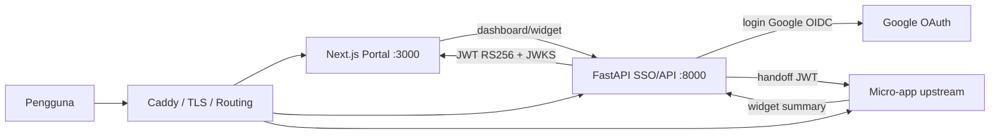

# MySuka Portal

**MySuka Portal** adalah gerbang tunggal (_superapp portal_) untuk layanan digital civitas akademika UIN Sunan Kalijaga. Portal menghubungkan:

- **SukaKetemu** — pencarian dan pelaporan barang;
- **CampusFix** — pelaporan kerusakan fasilitas;
- **SISKA** — layanan pengaduan dan perlindungan;
- **Archive** — materi dan arsip akademik;
- **PaaS Praktikum** — lingkungan dan manajemen praktikum.

Repository ini mengimplementasikan portal web, API identitas/SSO, routing edge, navbar bersama, design system, serta kontrak integrasi micro-app.

> Dokumentasi teknis: [`docs/`](./docs/), terutama `ADOPSI-MICROAPP.md`, `KONTRAK-v1.1-USULAN.md`, `IDENTITAS-DAN-DATA-PENGGUNA.md`, dan `DEPLOY-VPS.md`.

## Ringkasan arsitektur



| Komponen | Teknologi | Peran |
|---|---|---|
| Portal web | Next.js 15, React 19, TypeScript | Halaman publik, dashboard, verifikasi sesi, navigasi dan widget |
| Portal API | Python 3.12, FastAPI, PyJWT, HTTPX | Google OIDC, penerbitan JWT RS256, JWKS, silent launch, logout dan widget |
| Edge/VPS | Caddy 2, Docker Compose | TLS, routing origin, header keamanan dan pembersihan cookie portal |
| Micro-app | Framework apa pun | Layanan upstream dengan callback SSO dan endpoint widget opsional |
| Navbar bersama | Web Component/Shadow DOM | Navigasi lintas layanan melalui `/assets/superapp-navbar.js` |
| Design system | `design-system/build.mjs` + JSON | Token CSS/TypeScript/Dart dan pemeriksaan kontras |

## Teknologi utama

- **Frontend:** Next.js App Router, React, TypeScript, `jose`, npm.
- **Backend:** FastAPI, Pydantic, PyJWT, HTTPX, pytest.
- **Keamanan identitas:** OAuth/OIDC Authorization Code + PKCE, cookie HttpOnly, RS256, JWKS, `jti` anti-replay, HMAC-SHA256 untuk id buram.
- **Pengujian:** Node test runner, jsdom, tsx, pytest; Lighthouse CI tersedia.
- **Distribusi:** Docker multi-stage, Docker Compose, Caddy, output Next.js `standalone`.

## Struktur repository

```text
src/
  app/                 Halaman App Router: beranda, login, dashboard, layanan, dll.
  components/          Header, footer, kartu dan ikon layanan.
  lib/                 Konfigurasi layanan, sesi, JWT, widget, dan redirect aman.
  middleware.ts        Menghapus cookie portal sebelum request diteruskan ke micro-app.
portal-api/
  app/                 API FastAPI, SSO, identitas, kunci, token dan widget.
  tests/               Pengujian Python untuk API, keamanan, identitas dan widget.
design-system/         Sumber dan generator token lintas frontend.
navbar/                Implementasi komponen <superapp-navbar>.
scripts/               Build navbar serta upstream tiruan.
public/assets/         Aset bersama, navbar dan token CSS yang sudah dibangun.
infra/                 Docker Compose produksi dan Caddyfile.
docs/                  Kontrak, adopsi, identitas dan panduan deploy.
tests/                 Pengujian Node/TypeScript untuk cookie, navbar, token dan JWKS.
```

## Alur aplikasi

### Login

1. Pengguna membuka `/login` atau halaman yang mengarah ke dashboard.
2. `/api/sso/login` memulai OAuth Google dengan state, nonce dan PKCE.
3. Google mengirim pengguna ke `/api/sso/callback`.
4. FastAPI menukar authorization code, memvalidasi ID token, menerapkan pembatasan domain, lalu menerbitkan cookie sesi portal.
5. Next.js memverifikasi cookie menggunakan JWKS dari FastAPI; Next.js **tidak menyimpan atau memiliki kunci privat**.

### Navigasi ke layanan

1. Dashboard membuka `/api/sso/launch?app=<service>`.
2. API memvalidasi cookie sesi (tanda tangan, `typ`, belum dicabut) dan menerbitkan **kode otorisasi sekali pakai** (30 detik).
3. Pengguna diarahkan ke `/<service>/sso-callback?code=<kode>`; JWT tidak pernah berada di URL.
4. Backend micro-app menukar kode lewat `POST /api/sso/exchange` (`client_id` + `client_secret`, opsional PKCE) dan menerima JWT 60 detik ber-`aud` = id layanan, lalu memvalidasi signature, `iss`, `aud`, `exp`, `jti`, `svc` dan membuat sesi sendiri.
   Detail kontrak dan status temuan keamanan: [`docs/KEAMANAN.md`](docs/KEAMANAN.md).
5. Portal menyingkirkan cookie portal sebelum meneruskan trafik layanan; SISKA menerima isolasi tambahan.

### Dashboard widget

Dashboard memanggil `/api/widget/summary`. FastAPI mengumpulkan widget layanan secara paralel, memberi timeout tiap widget 1,5 detik, lalu menyembunyikan hasil yang gagal atau tidak valid. SISKA sengaja dikecualikan. Hasil widget di-cache dalam proses selama 45 detik.

## Identitas dan privasi

MySuka tidak menyimpan password dan tidak memiliki database pengguna. ID global dibentuk sebagai:

```text
usr_ + HMAC-SHA256(IDENTITY_HMAC_SECRET, "v1:<scope>:<campus_id>")[0:32]
```

- ID global digunakan oleh layanan biasa.
- SISKA dapat menggunakan ID khusus layanan sehingga tidak mudah dicocokkan lintas layanan.
- Klaim penuh berisi identitas portal yang diperlukan; layanan privasi hanya menerima ID dan peran.
- `campus_id` sementara menggunakan email sampai tersedia ID permanen dari sumber kampus.
- Token sesi berisi `jti`; layanan wajib menolak replay `jti` sesuai kontrak integrasi.

## Setup lokal

### Prasyarat

- Node.js 20.9+ (Docker memakai Node 22).
- Python 3.12+ direkomendasikan.
- Google OAuth credential untuk pengujian login sungguhan; login dev tidak memerlukan Google.

### 1. Konfigurasi environment

```bash
cp .env.example .env.local
```

Isi minimal variabel berikut untuk pengembangan:

```env
ENV=development
APP_BASE_URL=http://localhost:3000
SSO_ISSUER=http://localhost:3000
API_ORIGIN=http://127.0.0.1:8000
SSO_JWKS_URL=http://127.0.0.1:8000/.well-known/jwks.json
DEV_LOGIN=1
```

Tanpa `DEV_LOGIN=1`, API meminta konfigurasi Google melalui `GOOGLE_CLIENT_ID` dan `GOOGLE_CLIENT_SECRET`. Daftar lengkap tersedia di `.env.example`.

### 2. Instal dan jalankan

```bash
npm install
npm run api:install

# Terminal 1
npm run api:dev

# Terminal 2
npm run dev
```

Buka `http://localhost:3000`.

## Perintah pengembangan

| Perintah | Fungsi |
|---|---|
| `npm run dev` | Men-generate aset lalu menjalankan Next.js dev server |
| `npm run build` | Validasi aset, generate aset, lalu build Next.js produksi |
| `npm run start` | Menjalankan build Next.js (`output: standalone`)
| `npm run lint` | ESLint seluruh workspace |
| `npm run typecheck` | Pemeriksaan TypeScript tanpa emit |
| `npm run test` | Test Node/TypeScript di `tests/*.test.ts` |
| `npm run api:test` | pytest pada `portal-api/tests` |
| `npm run quality` | Aset + typecheck + test Node + test Python + build |
| `npm run lhci` | Lighthouse CI (memerlukan Chrome) |
| `npm run assets` | Build token CSS/TS/Dart dan bundle navbar |
| `npm run assets:check` | Memastikan aset hasil build sinkron dengan sumber |

## Pengujian

Test Node mencakup cookie, navbar, kontras/teks token, verifikasi JWKS dan pembatasan redirect. Test Python mencakup:

- JWKS dan JWT RS256;
- identitas serta pembatasan scope layanan;
- sesi dan dev login;
- OIDC/rate limit/CSRF;
- timeout dan validasi widget;
- endpoint SSO dan health check.

Jalankan semua pemeriksaan:

```bash
npm run quality
```

## Deployment VPS

Topologi produksi:

```text
Internet
  -> Caddy (80/443, TLS otomatis)
     -> /api/* dan /.well-known/jwks.json -> portal-api:8000
     -> /siska* dan layanan lain -> upstream micro-app
     -> rute lainnya -> portal-web:3000
```

Langkah ringkas:

```bash
cp .env.example .env.production
# Isi domain, origin layanan, Google OAuth, private key, dan identity secret.
openssl genpkey -algorithm RSA -pkeyopt rsa_keygen_bits:2048 -out priv.pem
openssl rand -hex 32

docker compose --env-file .env.production -f infra/docker-compose.yml up -d --build
```

Validasi konfigurasi Caddy sebelum deploy bila binary tersedia:

```bash
caddy validate --config infra/Caddyfile --adapter caddyfile
```

Panduan lengkap, DNS, OAuth redirect URI, health check, rotasi kunci dan operasi tersedia di [`docs/DEPLOY-VPS.md`](./docs/DEPLOY-VPS.md).

## Keamanan

- Cookie sesi API bersifat `HttpOnly`, `SameSite=Lax`; produksi memakai `Secure` dan default `__Host-mysuka_session`.
- Logout memakai POST serta pemeriksaan Origin.
- Return URL disaring agar tidak melakukan open redirect.
- Handoff JWT berttl 120 detik, scope layanan dan `jti`.
- SISKA tidak mendapat widget dan mendapat cookie/header isolasi ketat.
- CSP, HSTS, `nosniff`, frame denial dan permission policy diterapkan oleh Next/Caddy.
- Secret/kunci privat tidak ditempatkan di Next.js atau browser.
- Endpoint dokumentasi OpenAPI dinonaktifkan di produksi.

## Batasan saat ini

- Google adalah penyedia login saat ini; adaptor kampus/SSO masih dapat ditambahkan karena desain identitas memisahkan penyedia dari pembentukan JWT.
- `deriveUser` masih memakai email sebagai `campus_id` dan belum membaca fakultas/prodi dari direktori kampus.
- JWKS saat ini hanya memuat satu kunci; rotasi kunci tanpa downtime membutuhkan dukungan multi-kunci.
- Rate limit berada dalam memori satu worker FastAPI. Replikasi produksi membutuhkan Redis atau rate limiting pada edge.
- Penggantian token handoff di URL menjadi authorization code + PKCE direkomendasikan pada kontrak v1.1.
- Lighthouse dan validasi Caddy belum dapat dijalankan di semua lingkungan tanpa Chrome/Caddy.
- CSP masih memakai `'unsafe-inline'` untuk skrip karena Next menyisipkan inline script.

## Kontribusi

1. Jalankan `npm run lint`, `npm run typecheck`, `npm run test` dan `npm run api:test`.
2. Pastikan `npm run assets:check` berhasil setelah mengubah token atau navbar.
3. Jalankan `npm run build` sebelum deploy.
4. Ikuti kontrak pada `docs/ADOPSI-MICROAPP.md` ketika menambah atau memodifikasi micro-app.
